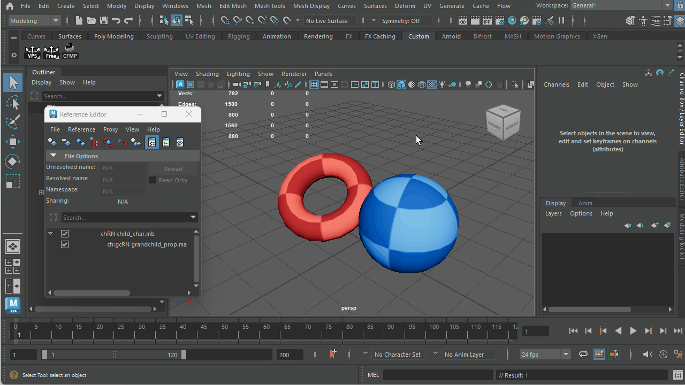

---

## English

### Overview

**Collect Files for Maya (CFM)** is a lightweight, non-destructive project collector for **Autodesk Maya** inspired by After Effects' *Collect Files* feature. It gathers your scene file and external assets into a clean project folder and generates a `workspace.mel` so your scene opens cleanly on any machine without broken paths.

This repository hosts the open-source **Free Edition**.

#### Free Edition Features
* **One-Click Asset Collection:** Collects scene textures and external assets into a unified folder structure (`scenes/` and `sourceimages/`).
* **Auto `workspace.mel` & Relative Paths:** Generates `workspace.mel` automatically so relative paths work across different PCs and drives.
* **Non-Destructive Workflow:** Keeps your current working scene, paths, and active workspace untouched.
* **Bilingual UI & Easy Setup:** Supports Japanese / English UI switching and drag-and-drop shelf installation with zero external dependencies.

### Free vs. Pro Comparison

| Feature | Free Edition (GitHub) | Pro Edition (CFMP) |
| :--- | :---: | :---: |
| Texture & External Asset Collection | ✅ | ✅ |
| Subfolder Organization & `workspace.mel` | ✅ | ✅ |
| **Recursive Nested References (`.ma` / `.mb`)** | — | ✅ |
| **UDIM & Frame Sequence Auto-Expansion** | — | ✅ |
| **Auto Collection Report (`collection_report.txt`)** | — | ✅ |
| **1-Click Delivery `.zip` Archive** | — | ✅ |

👉 **[Get CFM Pro on Gumroad (Launch Sale: $5)](https://mashitaya.gumroad.com/l/jwqvrf/6k511u9)** | **[Get CFM Pro on BOOTH (Japan)](https://yworks.booth.pm/items/9172929)**

### Installation

1. Download or clone this repository (`Code` > `Download ZIP`) and extract the files.
2. Drag and drop `install_CFM.mel` into the Maya viewport (or copy `collect_files_maya.py` to your Maya `scripts` folder).
3. Click the newly added **CFM** shelf button to launch the UI.

### Compatibility & License

* **Autodesk Maya:** 2022 – 2027 (Python 3 / PySide2 & PySide6)
* **OS:** Windows / macOS / Linux
* **License:** The **Free Edition** in this repository is open source. For nested reference recursion, UDIM/sequence expansion, reports, and ZIP packaging, check out **[CFM Pro on Gumroad](https://mashitaya.gumroad.com/l/jwqvrf/6k511u9)** or **[BOOTH](https://yworks.booth.pm/items/9172929)**.

---

## 日本語

### 概要

**Collect Files for Maya (CFM)** は、After Effects の「ファイルの収集」のように、**Autodesk Maya** のシーンデータと外部アセットを1クリックで指定フォルダへまとめ、`workspace.mel` を自動生成して相対パス化できる軽量・非破壊のプロジェクト収集ツールです。

このリポジトリでは、基本機能を備えたオープンソースの **無料版（Free Edition）** を公開しています。

#### 無料版（Free Edition）の主な機能
* **ワンクリック・外部ファイル収集：** シーン内のテクスチャ等の外部アセットを `scenes/` と `sourceimages/` に整理して一括コピーします。
* **workspace.mel 自動生成＆相対パス化：** 他のPCや別ドライブへフォルダごと移動してもリンク切れが起きない構成を自動作成します。
* **非破壊設計：** 収集後も現在開いている作業シーンのパスやプロジェクト設定は元のまま維持されます。
* **日英バイリンガルUI＆簡単導入：** 外部ライブラリ不要（Maya標準Pythonのみ）。`install_CFM.mel` をビューポートへドラッグ＆ドロップするだけでシェルフにボタン登録できます。

### 無料版（Free）と Pro版（CFMP）の機能比較

| 機能 | 無料版 (GitHub) | Pro版 (CFMP) |
| :--- | :---: | :---: |
| テクスチャ・外部ファイル収集 | ✅ | ✅ |
| フォルダ整理・`workspace.mel` 相対パス化 | ✅ | ✅ |
| **子・孫リファレンス再帰収集（`.ma` / `.mb`）** | — | ✅ |
| **UDIM・連番の一括収集** | — | ✅ |
| **収集・リンク切れ確認レポート（`collection_report.txt`）出力** | — | ✅ |
| **納品用 `.zip` 自動圧縮** | — | ✅ |

> **🎉 Pro版（CFMP）ローンチセール開催中（定価 600円 → 500円 / $7 → $5）：**
> 子・孫階層のネストされたリファレンス再帰収集やUDIM対応、収集レポート・納品用ZIP自動出力を備えた **CFM Pro** を特別価格で入手できます。
> 👉 **[BOOTHでPro版を購入する (セール価格 500円)](https://yworks.booth.pm/items/9172929)** | **[Gumroadで購入する (Launch Sale: $5)](https://mashitaya.gumroad.com/l/jwqvrf/6k511u9)**

### インストール方法

1. このリポジトリ上部の `Code` ＞ `Download ZIP` からファイルをダウンロードし、解凍します。
2. 同梱の `install_CFM.mel` を Maya のビューポートへドラッグ＆ドロップします。
3. シェルフに登録された **CFM** ボタンをクリックして起動します。

### 対応環境・ライセンス

* **対応Mayaバージョン：** Autodesk Maya 2022 – 2027（Python 3 / PySide2 & PySide6 対応）
* **対応OS：** Windows / macOS / Linux
* **ライセンス：** 本リポジトリの **無料版（Free Edition）** はオープンソースです。リファレンス再帰収集・UDIM対応・レポート・ZIP圧縮などの全機能を利用したい場合は、**[BOOTH](https://yworks.booth.pm/items/9172929)** または **[Gumroad](https://mashitaya.gumroad.com/l/jwqvrf/6k511u9)** にて **Pro版** をお求めください。
